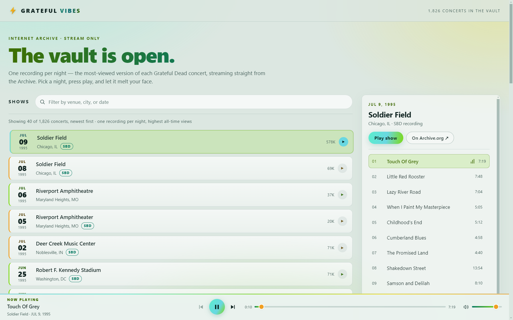
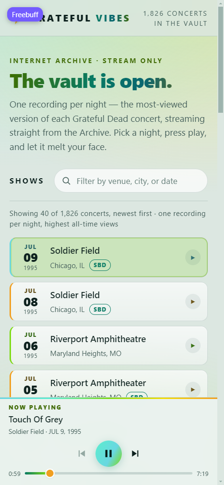

# Grateful Vibes

I built Grateful Vibes for my wife and for all of the other dead heads out there: as a way to explore and stream Grateful Dead live concerts from the Internet Archive. It is a static web app packaged as a Tauri 2
desktop and mobile app. The frontend is vanilla JavaScript + Vite + Bootstrap,
with no backend and no API keys.

Make no mistake this was totally vibe coded "Grateful **Vibes**" using: Github Copilot, Freebuff and ChatGPT.
- Copilot laid down the base.
- Freebuff offered up some of the best feature suggestions.
- ChatGPT executed with presision. It added Sonos playback in a single prompt.



<p align="center">
  
</p>

## Run it

```bash
npm install
npm run dev      # http://localhost:5173
npm run build    # static output in dist/
npm run preview  # serve the built output
```

Because the Archive's APIs send `Access-Control-Allow-Origin: *`, the built `dist/`
works on any static host. Serve it over HTTP rather than opening `index.html`
directly from disk.

### Desktop and mobile

The Tauri 2 shell uses the same Vite frontend and keeps the existing Archive.org
data flow. Install Rust 1.98+ (edition 2024) and the
[Tauri prerequisites](https://v2.tauri.app/start/prerequisites/) for your host OS
first. The JavaScript CLI is already installed as a dev dependency.

```bash
npm run desktop:dev      # native window with Vite hot reload
npm run desktop:build    # installer/bundle for the current desktop OS

npm run android:init     # one-time Android project generation
npm run android:dev      # Android device or emulator
npm run android:build

npm run ios:init         # one-time iOS project generation (macOS only)
npm run ios:dev           # iOS simulator or device (macOS only)
npm run ios:build
```

`npm run tauri dev` and `npm run tauri build` work as shorter aliases. Generated
mobile projects live in `src-tauri/gen/`. Windows bundles are written under
`src-tauri/target/release/bundle/`.

A few platform notes:

- **Android** needs the Android SDK, NDK, and a JDK 17+ toolchain. Point
  `ANDROID_HOME` and `NDK_HOME` at the SDK before running the mobile commands.
- **Android on Windows** also needs Windows Developer Mode (or the
  `SeCreateSymbolicLinkPrivilege`) because the Tauri CLI creates symlinks for the
  compiled native library. Without it, the build stops with `Creation symbolic
  link is not allowed for this system` before Gradle runs.
- **iOS** can only be built on macOS with Xcode. The `ios` subcommand is compiled
  out of the CLI on Windows, so `npm run ios:init` reports an unrecognized
  subcommand there.
- **Linux** packages are built on Linux (or a Linux CI runner); Windows and macOS
  bundle formats are built on their own hosts.
- The system webview is used on each platform, so background playback and
  lock-screen controls depend on that webview's Media Session support.

## What it does

- Loads every stream-only recording from the `GratefulDead` collection once
  (7,278 items) and collapses each concert date to a single show.
- Opens on four large browse buttons — **Venue**, **Year**, **City**, and
  **Song**. Venue and year open a picker built from the whole catalog (venues A–Z,
  years newest first). City drills down: **Country → State/Province → City**,
  skipping the middle level for countries whose coverage has no state/province.
  Song opens a searchable songbook; picking a song lists every show in Relisten's
  history for that song that also exists in the stream-only vault. Every level
  shows counts and lists that subset newest first, with a one-level back control
  and the four buttons still reachable.
- Offers 26 color themes, each named after a Grateful Dead song, selectable from the
  theme chip in the header: **Scarlet Begonias**, **Ripple**, **Brown-Eyed Women**,
  **Shakedown Street** (default), **Ship of Fools**, **Dark Star**, **The Other One**,
  **Sugar Magnolia**, **Touch of Grey**, **One More Saturday Night**, **Truckin'**,
  **Casey Jones**, **I Know You Rider**, **Box of Rain**, **Sugaree**, **Loser**,
  **Eyes of the World**, **Attics of My Life**, **Terrapin Station**, **Bertha**,
  **Peggy-O**, **Franklin's Tower**, **He's Gone**, **Friend of the Devil**,
  **China Cat Sunflower**, and **Let It Grow**. The choice is saved locally. Palette
  colors are also used as text inks for tags, counts, and alerts, so each one is lifted
  to a readable lightness before being used as ink — fills, borders, and gradients keep
  the original colors. A theme saved under its pre-song slug (for example
  `electric-vibes`) still resolves to its renamed palette, so an earlier choice is not
  reset to the default.
- Places are derived from Archive's free-text `coverage` field. US states and
  Canadian provinces are recognized from codes or full names, country aliases
  are collapsed (`USA`, `England` → United Kingdom, `EN`/`FR`/`GE` codes), and
  same-named cities in different states stay separate. Blank, `?`, `Various`,
  and unparseable coverage collects under one "Unknown" entry per level.
- Picks the most-viewed recording of each night: for every date, the item with
  the highest all-time views (Archive's `downloads` field) wins. Venue text is
  ignored when matching because the same concert is often tagged
  "Riverport Amphitheatre" on one recording and "Riverport Amphitheater" on another.
- Loads a show's tracklist from its Archive metadata and starts the first playable
  track automatically. The setlist can be filtered by song name once three
  characters are typed, while keeping the original track numbers and order.
- Streams with play/pause, next/previous, seek, volume, and OS media-key integration
  (Media Session API). With under 30 seconds left on a track, the next one is buffered
  into a second hidden `<audio>` element; in the final two seconds the two overlap in an
  equal-power crossfade, so consecutive tracks from a concert run together with no gap
  and no cut. Skipping, seeking, or pausing cancels the fade and acts immediately.
- On desktop, can optionally route playback to one or two discovered Sonos rooms
  over the local network. Two selected rooms join a Sonos group so they play in
  sync. The browser player remains the default output; room selection locks while
  playback is active and is released by Stop.
- Remembers the selected theme, volume, the last show and track position, and the
  six most recently played shows in `localStorage`. A reload or app restart restores the last track
  paused at the saved timestamp, ready to resume. A **Reset data** control in the
  header clears all of it and restores the default theme and volume.
- Keeps a **Favorites** list, opened from the sidebar. The star on a show row or in
  its track panel adds the concert; the same star removes it. Favoriting a show also
  stores its setlist in `localStorage` and downloads the audio into the browser's
  Cache Storage, one cache per show. A saved show then plays with no network: the
  setlist comes from the stored manifest and each cached track is played from a
  blob URL. The favorites view reports how many shows are saved offline, and each
  row carries its own offline status.
- Mirrors the open browse view into the URL — the dimension, its group or city
  drill-down, the selected song, and the filter text — so a view can be reloaded or
  shared. Filter changes use `replaceState`, so the back button stays navigation.
- Handles loading, empty, error, and unavailable-track states.

## Data endpoints

| Purpose | Endpoint |
| --- | --- |
| Show list | `https://archive.org/advancedsearch.php?q=collection:(GratefulDead AND stream_only)&fl[]=identifier&fl[]=date&fl[]=title&fl[]=venue&fl[]=coverage&fl[]=downloads&sort[]=date desc&rows=10000&page=1&output=json` |
| Show files | `https://archive.org/metadata/{identifier}` |
| Audio stream | `https://archive.org/download/{identifier}/{filename}` |
| Songbook | `https://api.relisten.net/api/v2/artists/grateful-dead/songs` |
| Song history | `https://api.relisten.net/api/v3/artists/grateful-dead/songs/{slug}` |

`advancedsearch.php` returns a `numFound` count (7,278 at the time of writing), all
of which fit in a single ~1.7 MB response. The whole catalog is fetched once and
deduped in memory, which avoids splitting a concert's recordings across page
boundaries. `metadata/{identifier}` returns a `files` array; the app prefers
`VBR MP3` derivatives, falling back to `MP3` and then `Ogg Vorbis`, and skips
files marked private.

The stream endpoint 302-redirects to a storage node that supports HTTP range
requests, so seeking and byte-range playback work in Chrome and Firefox.

Relisten's keyless, CORS-enabled API supplies the global song index. The songbook
is fetched lazily the first time **Song** is opened, and a song's history is
fetched only when that song is selected. Histories are cached in memory for the
rest of the session. Relisten has several upstream slugs for some songs (for
example, "Dark Star" has three); the app merges them by display name so a show is
listed once.

## Known limitations

- **One recording per night.** Deduping by date hides the other sources for that
  concert (audience tapes, matrices, alternate soundboards); only the most-viewed
  item is reachable in the UI.
- **Initial load pulls the full catalog.** That is one ~1.7 MB request (roughly
  1–3 seconds) before any shows appear; there is no incremental first paint.
- **Stream-only means stream-only.** Some files are restricted or disappear. When
  a derivative errors, the track is marked unavailable and playback skips ahead
  (up to five automatic retries in a row) instead of failing silently.
- **Persistence is local to one browser or app install.** The selected theme,
  volume, the last track position, the recently played list, and the favorites list
  live in `localStorage`; offline audio lives in Cache Storage. Clearing site data or
  app data removes them, and there is no cross-device sync. The header's **Reset
  data** button clears all of it — including cached audio — and restores the default
  theme.
- **Coverage text is inconsistent.** Country/state/city parsing assumes the
  last comma segment is a country or state code and the first is the city, so
  multi-city values and source-text coverage fall under Unknown, and a city and
  state/country that share a name cannot be told apart (e.g. Tbilisi, Georgia).
- **Venue text is inconsistent.** Archive venue strings vary widely (for example
  "Felt Forum, Madison Square Garden" vs. "Madison Square Garden"), and grouping
  only collapses case, whitespace, and Theatre/Theater spellings, so some
  near-duplicate venues remain separate entries.
- **Filtering is local.** Search narrows the current picker or the current
  drill-down's shows by venue, city, date, title, or source tag once three
  characters are typed; it does not query Archive.org. The setlist search covers
  the open show only, because Archive.org exposes track names one recording at a
  time. The global **Song** search queries Relisten instead.
- **Song history is Relisten's, not Archive's.** Relisten normalizes song names
  and may list dates that are not in this stream-only catalog. The app matches by
  date, so only performances that have a playable vault entry appear in the show
  list; the status line reports how many of Relisten's shows are available.
- **Offline copies are per favorite, per device.** Cache Storage is best-effort:
  it may be missing or disabled in some webviews and private windows, it is limited
  by the browser's storage quota (a full show is roughly 0.5–1.5 GB), and a refused
  or failed download leaves the favorite in place but streamable only. Downloads run
  in the foreground while the app is open, with no resume and no background sync.
  Offline audio is stored unencrypted in the app's cache, yet never leaves the
  device. Sonos players always fetch the Archive.org stream because a blob URL only
  exists on this device.
- **Archive.org availability.** If the API is slow or down the list shows an error
  with a retry. A favorited show that finished saving keeps playing offline, and
  its favorites view still renders from the stored metadata; everything else needs
  the network.
- **Native builds are host-specific.** macOS and iOS builds require a Mac; Linux
  bundles require Linux; Android builds require the Android SDK/NDK. The Tauri
  shell adds no native audio service, so background playback is whatever the
  platform webview provides.
- **Sonos local control uses legacy UPnP.** Sonos currently documents its public
  Control API as cloud based and says the LAN Control API is not generally
  available. The optional desktop room picker uses Sonos's older UPnP control
  interface, which Sonos labels unsupported and which can be disabled in
  Connection Security settings. Players must be reachable on the same local
  network with UPnP enabled. Archive streams are preflighted from the desktop,
  but an individual speaker may still reject a file or fail to fetch its
  redirected Archive.org URL.
- Out of scope by design: manual downloads beyond the automatic save for a
  favorite, accounts, user playlists, and non-Grateful-Dead content.
